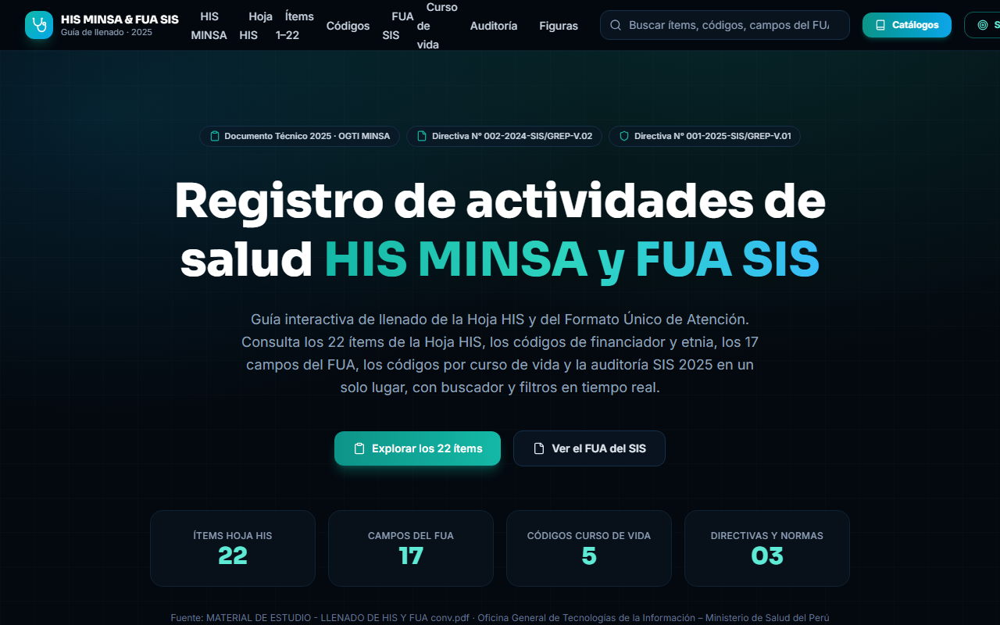
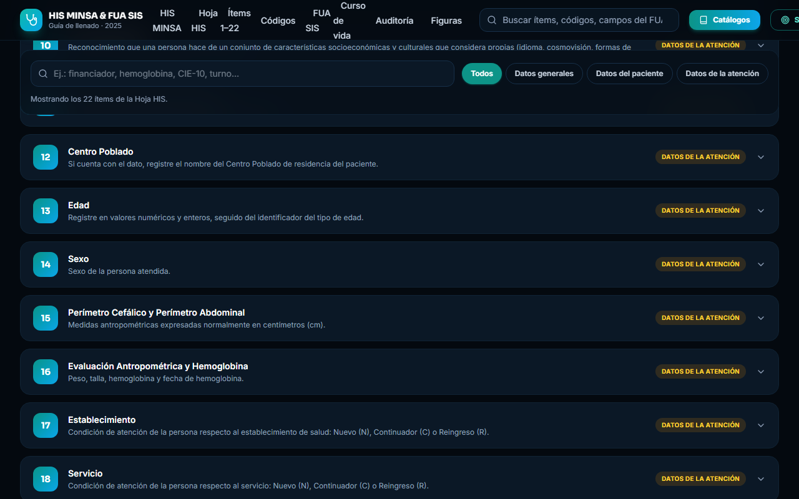
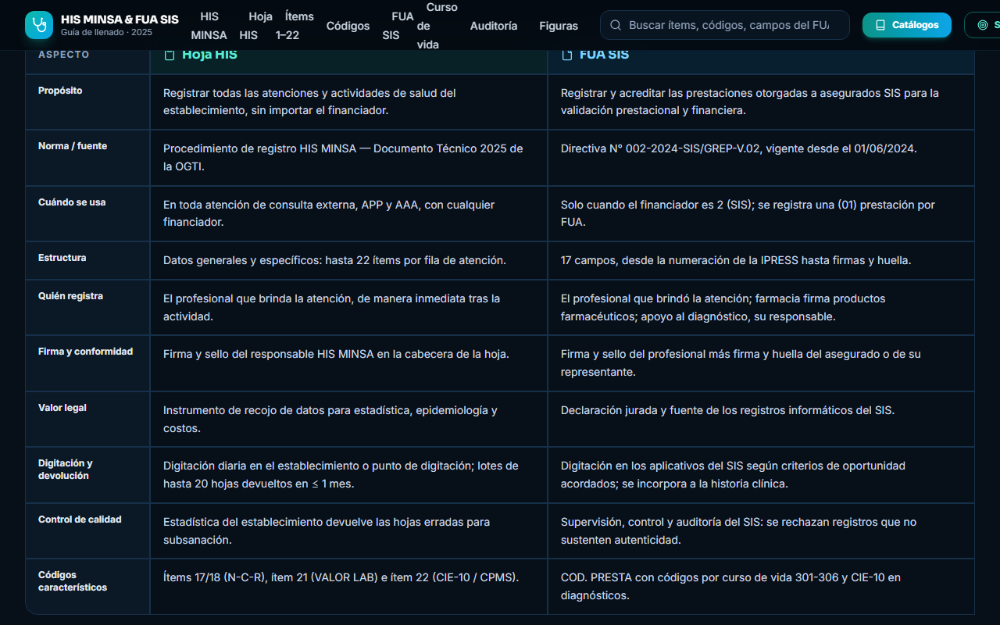
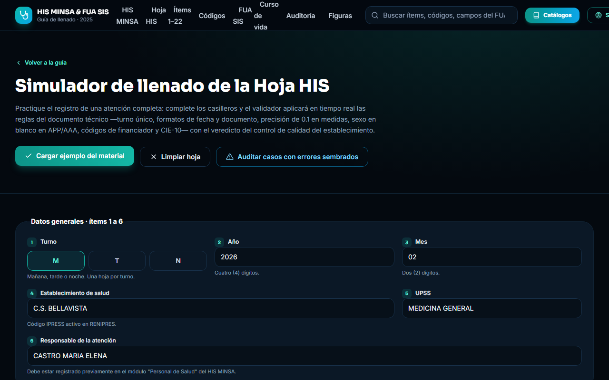
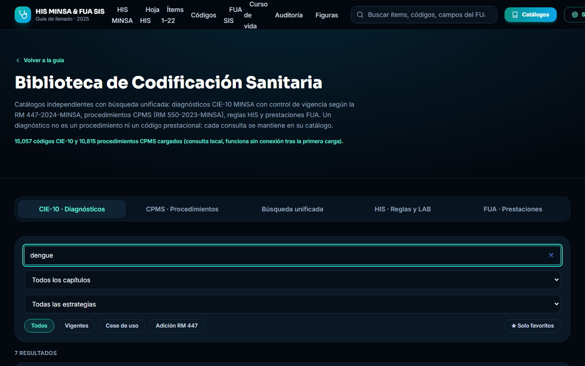
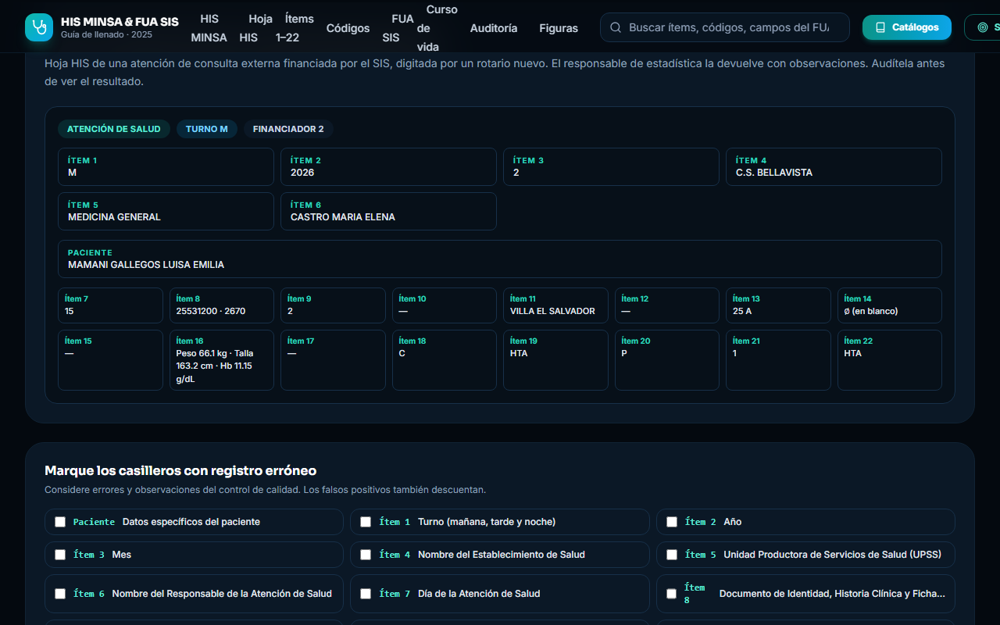
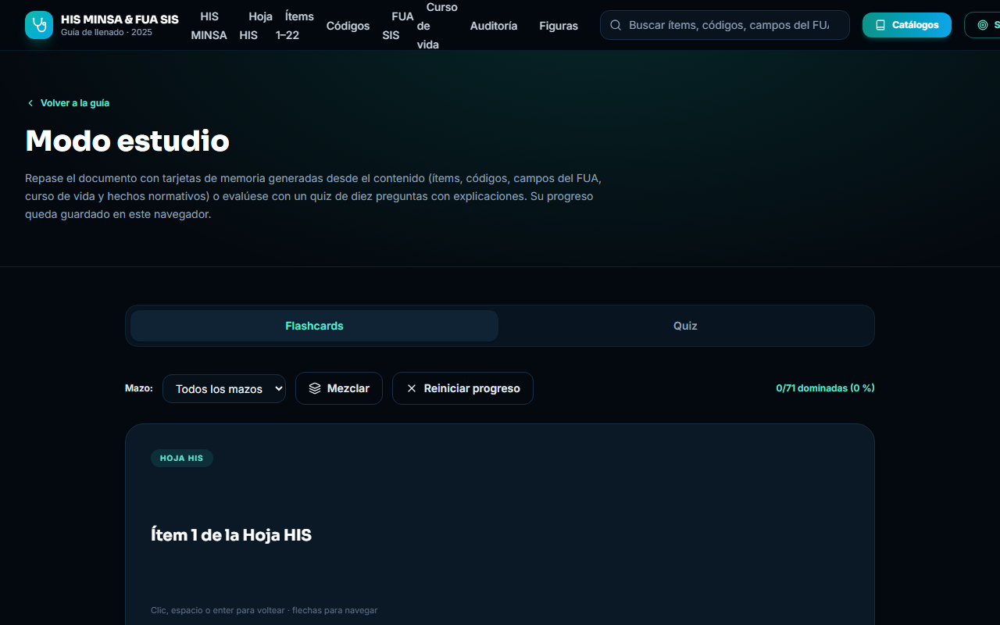
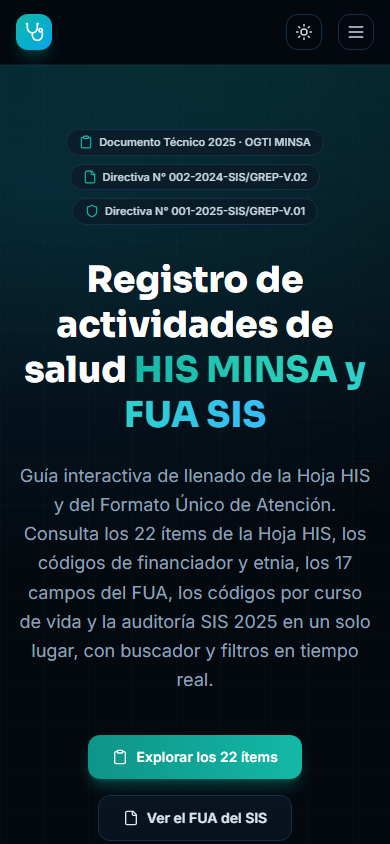

# HIS MINSA & FUA SIS — Guía interactiva y Biblioteca de Codificación Sanitaria

[](https://github.com/jylmdev-cyber/ayuda-his-fuas/actions/workflows/deploy.yml)
[](https://github.com/jylmdev-cyber/ayuda-his-fuas/actions/workflows/verificar-fuentes.yml)
[](https://astro.build)
[](https://tailwindcss.com)
[](https://www.typescriptlang.org)
[](https://vitest.dev)
[](https://jylmdev-cyber.github.io/ayuda-his-fuas/)
[](https://developer.mozilla.org/docs/Web/Progressive_web_apps)
[](https://www.minsa.gob.pe/reunis/index.asp?op=3)

Sitio estático **100 % sin backend** que digitaliza el documento *"MATERIAL DE ESTUDIO – LLENADO DE HIS Y FUA"*
(Oficina General de Tecnologías de la Información – MINSA, 2025) y lo convierte en una herramienta de
consulta, práctica y codificación para personal asistencial, responsables de estadística y estudiantes:
guía interactiva de la Hoja HIS y el FUA, simulador de llenado con control de calidad, asistente de código
prestacional, casos de auditoría, modo estudio y una biblioteca con los catálogos oficiales
**CIE-10 MINSA (15 057 códigos)** y **CPMS (10 815 procedimientos)**.

> **Demo:** https://jylmdev-cyber.github.io/ayuda-his-fuas/ · **Repo:** https://github.com/jylmdev-cyber/ayuda-his-fuas

---

## Capturas

| | |
|:---:|:---:|
|  |  |
| *Portada: métricas y normas vigentes* | *Explorador de los 22 ítems con búsqueda y filtros* |
|  |  |
| *Tabla comparativa Hoja HIS vs FUA SIS* | *Simulador de llenado con ejemplo del material* |
|  |  |
| *Biblioteca: CIE-10 con vigencia RM 447-2024* | *Auditoría de hojas con errores sembrados* |
|  |  |
| *Flashcards y quiz con progreso local* | *Diseño mobile-first* |

---

## Stack tecnológico

| Capa | Tecnología | Detalle |
|---|---|---|
| Framework | **Astro 5** (TypeScript estricto) | Salida estática, 30 rutas, islas cero: solo scripts vanilla agrupados por página |
| Estilos | **Tailwind CSS 4** vía `@tailwindcss/vite` | Tema oscuro por defecto con toggle persistente, tokens propios (`night`, `brand`, `accent`) |
| Datos | `src/data/content.ts` + JSON generados | Todo el contenido tipado; los catálogos viven en `public/data/*.json` |
| Iconos | SVG inline (`Icon.astro`) | Set propio estilo lucide, sin dependencias |
| Tests | **Vitest** (29 tests) + Playwright (capturas) | El CI ejecuta `npm test` antes del build |
| Hosting | **GitHub Pages** + Actions | `deploy.yml` (build+deploy) y `verificar-fuentes.yml` (cron mensual) |
| Offline | **PWA** | `manifest.webmanifest` + `sw.js` (navegaciones network-first, assets stale-while-revalidate) |
| SEO | Sitemap, JSON-LD, OG image | 22 páginas estáticas de capítulos CIE-10 indexables sin JS |

## Módulos del sistema

| Ruta | Módulo | Qué hace |
|---|---|---|
| `/` | Guía interactiva | Los 4 bloques del documento: HIS MINSA, Hoja HIS (22 ítems), FUA (Directiva 002-2024), curso de vida 301-306 y auditoría (Directiva 001-2025); buscador global, explorador con filtros, figuras del PDF con lightbox y tabla comparativa HIS vs FUA |
| `/simulador/` | Simulador de llenado | Formulario de los 22 ítems con ~30 reglas validadas en vivo (turno único, precisión 0.1, sexo en blanco en APP/AAA, formatos DNI/APP/AAA/CIE-10…) y veredicto del control de calidad; acepta códigos precargados desde la biblioteca (`?cie=`, `?cpms=`) y busca en los catálogos oficiales desde el ítem 22 |
| `/asistente/` | Asistente prestacional | Calcula edad exacta a la fecha de atención, sugiere ítem 13 y el código por curso de vida (COD. PRESTA.) con línea de tiempo etaria y checklist de reglas FUA |
| `/casos/` | Casos de auditoría | Hojas con errores sembrados para auditar: puntaje de detectados/omitidos/falsos positivos contra el mismo motor de reglas |
| `/estudio/` | Modo estudio | 71 flashcards por mazos con progreso persistente y quiz de 10 preguntas generadas desde el contenido |
| `/catalogos/` | Biblioteca de codificación | Exploradores CIE-10 y CPMS independientes, búsqueda unificada, filtros por capítulo/estrategia/estado, favoritos, recientes y ficha con fuente normativa |
| `/catalogos/cie10/capitulo-*/` | Capítulos estáticos | 22 páginas SEO sin JavaScript con todos los códigos, anclas por código y JSON-LD |
| `/glosario/` | Glosario | 26 términos con búsqueda y enlace a la sección donde se aplican |

## Arquitectura de datos

```
src/data/content.ts        ← fuente única del contenido del PDF (tipado estricto)
src/data/casos.ts          ← hojas base + errores sembrados de auditoría
src/scripts/reglas-his.ts  ← motor de reglas compartido (simulador + casos)
src/scripts/catalogo-loader.ts ← carga/caché/búsqueda de los JSON oficiales
public/data/cie10.json     ← 15 057 códigos (compacto: tablas de cadenas + bitmask)
public/data/cpms.json      ← 10 815 procedimientos
public/data/catalogos-meta.json ← conteos, fuentes y fecha de generación
```

Pipeline de catálogos oficiales (`npm run import:catalogos`):

1. Descarga de `files.minsa.gob.pe`: Excel CIE-10 (VOLUMEN VIGENTE), PDF de la RM 447-2024
   (Anexo 1 uso / Anexo 2 cese) y ZIP del CPMS (RM 550-2023).
2. Normalización: jerarquía capítulo→grupo→categoría→subcategoría, corrección de errores
   tipográficos de las fuentes (`I→1`, `O→0`), celdas combinadas del CPMS y códigos alfanuméricos.
3. Vigencia: el Anexo 2 marca `cesado`; los códigos del Anexo 1 ausentes del volumen se añaden
   como adición; todo con `fuente` y `fechaVerificacion` por registro.
4. Salida compacta con tablas de cadenas (6,4 MB → 1,4 MB) y caché `localStorage` para uso offline.

## Scripts

| Comando | Descripción |
|---|---|
| `npm run dev` | Servidor de desarrollo en `http://localhost:4321/ayuda-his-fuas` |
| `npm run build` | Build estático + sitemap en `dist/` |
| `npm run preview` | Sirve `dist/` con la ruta base real |
| `npm test` | Suite Vitest (reglas, contenido y calidad de catálogos) |
| `npm run import:catalogos` | Reimporta CIE-10/CPMS/RM 447 desde las fuentes oficiales |
| `npm run generar:og` | Regenera `public/og-image.png` (1200×630) |
| `npm run capturas` | Regenera las capturas del README con Playwright |

## Desarrollo local y despliegue

```bash
npm install
npm run dev

# publicar
git remote add origin https://github.com/jylmdev-cyber/ayuda-his-fuas.git
git push -u origin main
# GitHub → Settings → Pages → Source: GitHub Actions
```

`astro.config.mjs` fija `site` y `base` para el subdirectorio de Pages; si cambias el nombre del
repo, ajusta `base`, `public/robots.txt` y el texto de `scripts/generar-og.mjs`.
El workflow `verificar-fuentes.yml` revisa mensualmente las fuentes oficiales y abre un PR
automático si los catálogos cambiaron.

## Descargo

Herramienta **educativa** de consulta y revisión de registros: no reemplaza al aplicativo HIS MINSA
ni a los aplicativos del SIS, no diagnostica pacientes y no garantiza la aceptación de una
prestación. Fuentes: [REUNIS – MINSA](https://www.minsa.gob.pe/reunis/index.asp?op=3),
[RM 447-2024-MINSA](https://www.gob.pe/institucion/minsa/normas-legales/5689118-447-2024-minsa),
[BVS – Manuales del HIS](https://bvs.minsa.gob.pe/manuales-del-sistema-de-informacion-his/).
